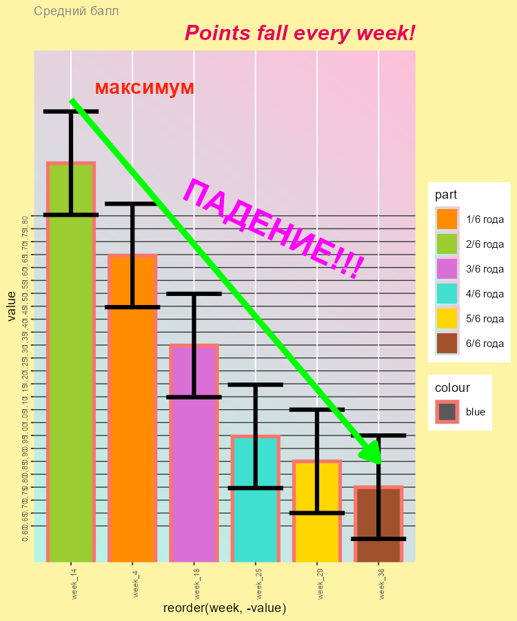
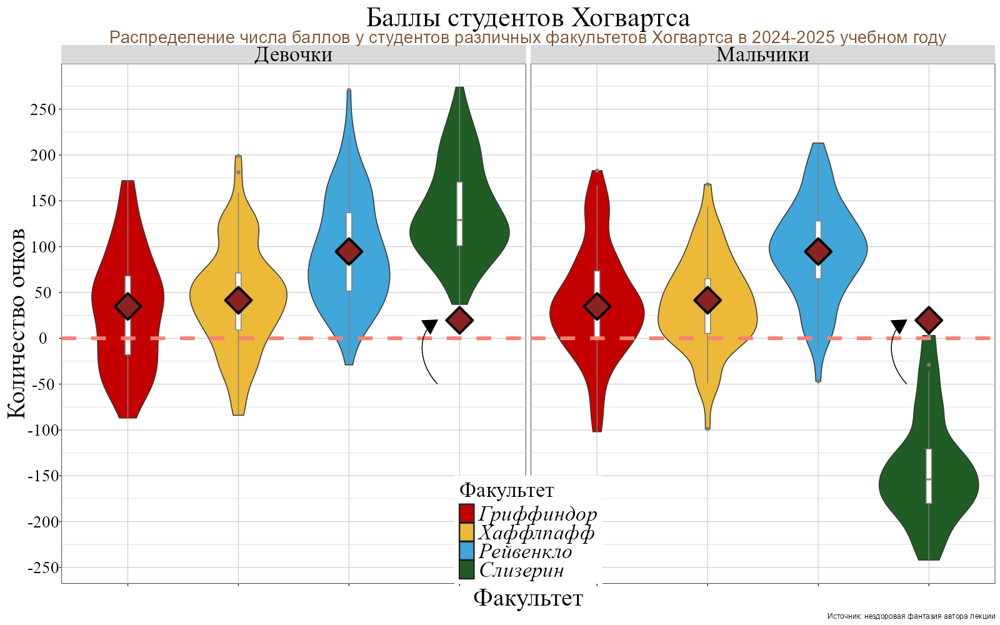

# О задании

В этом задании почти соблюдаются принципы классицизма: одно задание — не меньше одного графика и не меньше одного чанка, если не сказано иное. Правило действует, даже когда задание просит вернуться к предыдущему графику. При этом вы всегда можете расширить интерпретацию или показать то же самое ещё и другим, более подходящим, на ваш взгляд, способом — дополнительными графиками к заданию. Некоторые пункты касаются того, о чём на занятиях прямо не говорили, и потребуют справки и документации; обычно такие места оговорены в условии явно.

Инструкция по сдаче задания указана в `README.md` и на Stepik

## **Общие требования к оформлению**

1. Старайтесь соблюдать единый стиль оформления и структуру отчёта, если в задании не указано иное. Не оставляйте в финальном отчёте лишние чанки кода, текст или комментарии, которые не относятся к решению задания.
2. Любой output должен быть читаемым и достаточно кратким, чтобы было удобно просматривать. Не оставляйте «полотна» текста или вывода. Объёмный output оформите аккуратно, либо сократите, либо вовсе уберите. Таблицы оформляйте c пмощью flextable, а для графиков подбирайте подходящий размер и пропорции
3. Ответы на вопросы оформляйте в виде текста явно, не в виде комментариев к коду.
4. Сохраняйте исходную структуру проекта в репозитории. Не добавляйте лишние файлы, которые не относятся к проекту или выполнению заданий.
5. Оформление коммитов и веток на GitHub должно соответствовать общим правилам для всех курсов Института биоинформатики (см. соответствующий материал на курсе Python).

# Правила и требования для всех задач *в этом домашней задании*

**Выполняйте их, даже если в тексте задания они не упомянуты.**

- Под каждым графиком напишите интерпретацию: что на нём видно и какой вывод из этого следует, в 2–4 предложениях. Перечисление геомов и цветов интерпретацией не считается. Если вывода нет или данных для него мало, так и напишите.
- Делайте текст на графике настолько крупным, насколько позволяют сам график и ваше чувство меры. Читаемые надписи — важный (но не так уж часто встречающийся) элемент графиков.
- Не используйте фон ggplot2 по умолчанию.
- У каждого графика должен быть заголовок, отражающий его суть, и правильно названные оси.
- Все подписи на графиках — на русском языке.
- Старайтесь, чтобы графики были достаточно крупными и читались не только в отрендеренном HTML, но и при интерактивном запуске чанков в Positron.
- Однотипные графики стройте функцией (конспект 2, раздел «П6 · Функция для однотипных графиков (слайд П6)»).
- Цвета факультетов — как в конспектах: Гриффиндор `#B32025`, Хаффлпафф `#D7A900`, Рейвенкло `#2E5EAA`, Слизерин `#2F7D4A`. В задании 10 цвета берите с образца.

Для некоторых заданий понадобится пакет patchwork: он собирает несколько графиков в один (конспект 2, раздел «П9 · Несколько графиков на одну страницу (слайд П9)»). Советуем почитать его документацию и пользоваться им в домашней работе. Для задания 8 нужен пакет gghighlight. Если каких-то пакетов нет, установите их один раз в консоли: `install.packages(c("patchwork", "gghighlight"))`.

Если, пока вы строите и интерпретируете график, у вас появилась гипотеза, не стесняйтесь её проверить: постройте для того же задания ещё один график (или несколько), проведите дополнительное исследование.

# Подготовка

```{r setup}
#| message: false

library(tidyverse)
library(patchwork)
library(gghighlight)

theme_set(theme_minimal(base_size = 14))

hogwarts <- read_csv("data/hogwarts_2026.csv", show_col_types = FALSE)
```

# Задание 1

Постройте барплот (столбчатую диаграмму), отражающий распределение числа студентов по курсам обучения. Раскрасьте столбики любым понравившимся цветом: подойдёт и название цвета, и hex-код. Задайте и цвет контура столбиков. Проинтерпретируйте график.

```{r task-1}
sex_names <- c(female = "Девушки", male = "Юноши")
house_names <- c(
  Gryffindor = "Гриффиндор",
  Slytherin  = "Слизерин",
  Ravenclaw  = "Когтевран",
  Hufflepuff = "Пуффендуй"
)

ggplot(hogwarts, aes(x = house, fill = sex)) +
  geom_bar(color = "black") +
  scale_fill_manual(
    values = c(female = "#f4bff8", male = "#b9d3fa"),
    labels = sex_names
  ) +
  scale_x_discrete(labels = house_names) +
  labs(
    title = "Распределение числа студентов по факультетам и полу", 
    fill = "Пол",
    x = "Факультеты",
    y = "Количество студентов"
  ) +
  theme_minimal(base_size = 16)
```

**Интерпретация:** 
Среди факультетов школы магии и волшебства "Хогвартс" самым многочисленным оказался факультет Пуффендуй, где суммарно с 1 по 7 курс обучается 150 человек. На втором месте по количеству студентов оказался факультет Гриффендор, за ним Когтерван и Слизерин. Количество девушек на всех факультетах, кроме Гриффендор, привалирует над количеством юношей.

# Задание 2

Постройте новый барплот, отражающий распределение числа студентов по факультетам. Добавьте на график вторую факторную переменную — происхождение (`bloodStatus`).

С помощью аргумента `position` измените график так, чтобы каждый столбец показывал распределение факультета по чистоте крови в долях. Запишите текстом в этом файле, какой вывод можно сделать из графика.

```{r task-2}
blood_colours <- c(
  `half-blood`  = "#A8D5BA",
  `muggle-born` = "#F4A261",
  `pure-blood`  = "#E76F51"
)

blood_names <- c(
  `half-blood`  = "Полукровки",
  `muggle-born` = "Из семей маглов",
  `pure-blood`  = "Чистокровные"
)

ggplot(hogwarts, aes(y = house, fill = bloodStatus)) +
  geom_bar(position = "dodge2") +
 
  scale_y_discrete(labels = house_names) +
  
  scale_fill_manual(
    values = blood_colours,
    labels = blood_names
  ) +
  labs(
    fill = "Статус крови",
    x = "Количество студентов",
    y = "Факультеты",
    title = "Соотношение студентов на факультетах в зависимости от происхождения"
  ) +
  theme_minimal(base_size = 14) +
  theme(plot.title = element_text(hjust = 0.5, face = "bold"))
```

**Вывод:**
Наибольшую долю студентов среди всех факультетов составили представители из смешанных семей, самым многочисленным по количеству таких учащихся оказался Пуффендуй. Вторыми по преобладанию оказались чистокровные чародеи, коих большинство на Слизерин. Гриффиндор оказался самым популярным среди выходцев из семей маглов. Интересно отметить, что из всех факультетов дом Слизерин оказался единственным не принимающим к себе волшебников из семей простых смертных.

# Задание 3

Отобразите распределение баллов, заработанных студентами на 3-й неделе обучения, по факультетам. Постарайтесь показать одновременно и форму распределения, и некоторые описательные статистики. Отсортируйте факультеты в порядке убывания медианного балла за 3-ю неделю (функция, которую мы разбирали на слайде 21, по умолчанию сортирует именно по медиане, так что задавать медиану отдельным аргументом не нужно). Если используете `geom_jitter()`, постарайтесь, чтобы точки лежали кучнее вдоль оси, которая не отражает само распределение. Проинтерпретируйте график.

```{r task-3}
set.seed(2026)

house_colours <- c(
  Gryffindor = "#B32025", Hufflepuff = "#D7A900",
  Ravenclaw  = "#2E5EAA", Slytherin  = "#2F7D4A"
)

hogwarts |>
  mutate(house = fct_reorder(house, week_3, .fun = median, .desc = TRUE)) |>
  ggplot(aes(x = house, y = week_3, fill = house)) +
  geom_boxplot(alpha = 0.3, outlier.shape = NA, width = 0.6, color = "black") +
  geom_jitter(width = 0.15, height = 0, alpha = 0.4, size = 1.5) +
  stat_summary(
    fun = median, geom = "point",
    shape = 18, size = 5, color = "red"
  ) +
  scale_fill_manual(values = house_colours, guide = "none") +
  labs(
    title = "Распределение баллов за 3 неделю по факультетам",
    x = "Факультеты",
    y = "Баллы за 3 неделю"
  ) +
  theme_minimal(base_size = 14) +
  theme(
    plot.title = element_text(hjust = 0.5, face = "bold", size = 16)
  )+
  scale_x_discrete(labels = house_names)
```

**Интерпретация:** 
Студенты факультетов Когтерван,Гриффиндор и Слизерин набирали больше всех баллов по итогам 3 недели. В то же время студент Когтерван умудрился получить самые низкие штрафные баллы из всех. Медианы примерно одинаковые среди Гриффендор и Когтерван, Немного ниже у Пуффендуй и самая низкая на Слизерин.

# Задание 4

Постройте гистограмму результатов любого экзамена на ваш выбор, кроме зельеварения. Настройте оптимальное, на ваш взгляд, число столбцов гистограммы. Выполните фасетирование по курсу. Постарайтесь, чтобы график был по возможности компактным. Проинтерпретируйте график.

```{r task-4}
set.seed(2026)

house_colours <- c(
  Gryffindor = "#B32025", Hufflepuff = "#D7A900",
  Ravenclaw  = "#2E5EAA", Slytherin  = "#2F7D4A"
)

hogwarts |>
  ggplot(aes(x = `Defence against the dark arts exam`, fill = house)) +
  geom_histogram(binwidth = 5, boundary = 0) +   # ← было 25, стало 10
  facet_wrap(vars(house), labeller = labeller(house = house_names)) +
  scale_fill_manual(values = house_colours, guide = "none") +
  labs(
    title = "Распределение баллов за экзамен по защите от тёмных искусств",
    x = "Баллы за экзамен",
    y = "Количество студентов"
  ) +
  theme_minimal(base_size = 14) +
  theme(
    plot.title = element_text(hjust = 0.5, face = "bold", size = 16),
    panel.spacing.x = unit(1.5, "lines"),
    plot.margin = margin(6, 14, 6, 6)
  )

```

**Интерпретация:** По итогам экзамена по предмету "Защита от темных искусств" наиболее высокие баллы чаще получали студенты факультета Когтерван, этот же факультет отличился наименьшим количеством низких баллов, по сравнению с остальными. На Слизерин напротив половина факультета получила низкие баллы, но в то же время вторая половина получала баллы выше среднего, даже есть стобальники. Пуффендуй и Гриффиндор получали примерно одинаковые оценки, хотя большинство студентов получило низкие баллы, доля учащихся с оценками выше средней больше, чем у Слизерин, но меньше Когтерван. Однако на Гриффиндоре тоже отыскались стобальники. 

# Задание 5

Постройте скаттерплот, показывающий связь между суммарным баллом студента за год и оценкой за экзамен (по травологии, магловедению, нумерологии и зельеварению). Добавьте на график линию тренда. Удалите доверительную область и сделайте линию прямой. Подумайте, как обойтись без того, чтобы записывать одни и те же координаты x и y дважды. Проинтерпретируйте график.

Раскрасьте точки в разные цвета в соответствии с факультетами. Проинтерпретируйте полученный результат.

```{r task-5}

exam_names <- c(
  `Herbology exam`      = "Травология",
  `Muggle studies exam` = "Магловедение",
  `Arithmancy exam`     = "Нумерология",
  `Potions exam`        = "Зельеварение"
)

house_colours <- c(
  Gryffindor = "#B32025", Hufflepuff = "#D7A900",
  Ravenclaw  = "#2E5EAA", Slytherin  = "#2F7D4A"
)

hogwarts_long <- hogwarts |>
  select(result, house,
         `Herbology exam`, `Muggle studies exam`,
         `Arithmancy exam`, `Potions exam`) |>
  pivot_longer(
    cols = c(`Herbology exam`, `Muggle studies exam`,
             `Arithmancy exam`, `Potions exam`),
    names_to  = "exam",
    values_to = "score"
  )

ggplot(hogwarts_long, aes(x = result, y = score, color = house)) +
  geom_point(alpha = 0.4, size = 1.5) +
  geom_smooth(method = "lm", se = FALSE, color = "black", linewidth = 1) +
  facet_wrap(~ exam, labeller = labeller(exam = exam_names)) +
  scale_color_manual(
    values = house_colours,
    labels = house_names,
    name = "Факультет"
  ) +
  labs(
    title = "Связь суммарного балла за год с оценками за экзамены",
    x = "Суммарный балл за год",
    y = "Оценка за экзамен"
  ) +
  theme_minimal(base_size = 14) +
  theme(
    plot.title = element_text(hjust = 0.5, face = "bold", size = 16),
    legend.position = "bottom"
  )
```

**Интерпретация:**
На всех графиках видна положительная связь между суммарным баллом за год и оценкой за экзамен: чем выше итоговый балл студента, тем лучше он сдавал экзамен. Наклон линий тренда примерно одинаков для всех предметов, что говорит о том, что общий уровень успеваемости студента важнее специфики конкретного экзамена.
Цветовое разделение по факультетам показывает, что студенты всех факультетов распределены по всему диапазону баллов. Однако на графике по зельеварению заметно, что студенты Слизерина в среднем имеют более высокие оценки при том же суммарном балле.
# Задание 6

Сравните распределение баллов за экзамен по прорицанию и за экзамен по защите от тёмных искусств. Сделайте это тремя разными способами. Под разными способами понимаются идеологически разные геомы или способы группировки. Не считаются разными способами изменения константных визуальных параметров (цвет заливки, размер фигур, другие чисто стилевые отличия) на сходных в остальном графиках.

Объедините графики так, чтобы итоговый график имел два столбца и две строки. Два графика должны стоять в верхней строке и занимать равную площадь. Третий график должен занимать нижнюю строку целиком. Проинтерпретируйте график.

```{r task-6}
# Гистограммы
plot1 <- ggplot(hogwarts, aes(x = `Divinations exam`)) +
  geom_histogram(binwidth = 10, fill = "#2E5EAA", color = "black", alpha = 0.7) +
  facet_wrap(~ "Прорицание") +
  labs(x = "Баллы", y = "Количество студентов", title = "Гистограмма: Прорицание") +
  theme_minimal(base_size = 12) +
  theme(plot.title = element_text(hjust = 0.5))

plot2 <- ggplot(hogwarts, aes(x = `Defence against the dark arts exam`)) +
  geom_histogram(binwidth = 10, fill = "#B32025", color = "black", alpha = 0.7) +
  facet_wrap(~ "Защита от тёмных искусств") +
  labs(x = "Баллы", y = "Количество студентов", title = "Гистограмма: Защита от тёмных искусств") +
  theme_minimal(base_size = 12) +
  theme(plot.title = element_text(hjust = 0.5))

# Боксплот
plot3 <- ggplot(hogwarts) +
  geom_boxplot(
    aes(x = "Прорицание", y = `Divinations exam`),
    fill = "#2E5EAA", alpha = 0.7
  ) +
  geom_boxplot(
    aes(x = "Защита от тёмных искусств", y = `Defence against the dark arts exam`),
    fill = "#B32025", alpha = 0.7
  ) +
  labs(x = "Экзамен", y = "Баллы", title = "Boxplot: сравнение распределений") +
  theme_minimal(base_size = 12) +
  theme(plot.title = element_text(hjust = 0.5))

# Вайлинплот
plot4 <- ggplot(hogwarts) +
  geom_violin(
    aes(x = "Прорицание", y = `Divinations exam`),
    fill = "#2E5EAA", alpha = 0.7
  ) +
  geom_violin(
    aes(x = "Защита от тёмных искусств", y = `Defence against the dark arts exam`),
    fill = "#B32025", alpha = 0.7
  ) +
  labs(x = "Экзамен", y = "Баллы", title = "Violin plot: форма распределения") +
  theme_minimal(base_size = 12) +
  theme(plot.title = element_text(hjust = 0.5))

final_plot <- (plot1 + plot2) / (plot3 + plot4)

final_plot
```

**Интерпретация:**
На графиках видно, что распределение баллов за экзамен по прорицанию смещено в сторону более низких баллов по сравнению с экзаменом по защите от тёмных искусств, где образовалось 2 "горба" из низких и высоких баллов. 
Боксплот показывает, что разброс баллов за прорицание больше, что указывает на большую вариативность успеваемости по этому предмету. Вайлинплот показывает, что большинство студентов набрали относительно низкие баллы, тогда как по защите от тёмных искусств распределение более симметричное.
Таким образом, студенты в среднем лучше справляются с экзаменом по защите от тёмных искусств, чем с экзаменом по прорицанию.

# Задание 7

Постройте диаграмму рассеяния (скаттерплот), где по осям отложены результаты экзаменов по заклинаниям и по древним рунам. На графике есть некоторая проблема. Если вам трудно её определить, возьмите подсказку: постройте скаттерплот по данным из файла `data/podskazka.csv`. По оси x отложите переменную `y`, по оси y — переменную `x`, а пределы оси y задайте от 200 до 500. Предложите и подкрепите визуализациями не менее трёх способов решить эту проблему.

```{r task-7}
exam_names <- c(
  `Charms exam` = "Заклинания",
  `Study of ancient runes exam` = "Древние руны"
)

ggplot(hogwarts, aes(x = `Charms exam`, y = `Study of ancient runes exam`)) +
  geom_point(alpha = 0.3, size = 2, color = "#2E5EAA") +
  labs(
    title = "Способ 1: Меняем прозрачность",
    subtitle = "Чем темнее область — тем больше студентов",
    x = "Баллы за экзамен по заклинаниям",
    y = "Баллы за экзамен по древним рунам"
  ) +
  theme_minimal(base_size = 14) +
  theme(plot.title = element_text(face = "bold"))
```

```{r}
set.seed(2026)
ggplot(hogwarts, aes(x = `Charms exam`, y = `Study of ancient runes exam`)) +
  geom_jitter(width = 2, height = 2, alpha = 0.5, size = 1.5, color = "#B32025") +
  labs(
    title = "Способ 2: Jitter — случайное смещение точек",
    x = "Баллы за экзамен по заклинаниям",
    y = "Баллы за экзамен по древним рунам"
  ) +
  theme_minimal(base_size = 14) +
  theme(plot.title = element_text(face = "bold"))
```

```{r}
ggplot(hogwarts, aes(x = `Charms exam`, y = `Study of ancient runes exam`)) +
  geom_hex(bins = 20) +
  scale_fill_viridis_c(name = "Количество студентов", option = "plasma") +
  labs(
    title = "Способ 3: Двумерная гистограмма (hexbin)",
    x = "Баллы за экзамен по заклинаниям",
    y = "Баллы за экзамен по древним рунам"
  ) +
  theme_minimal(base_size = 14) +
  theme(plot.title = element_text(face = "bold"))
```


**Проблема и способы её решения:** Мы столкнулись с проблемой так называемого оверплоттинга. Оверплоттинг может произойти в случаях, когда многие студенты набирают одинаковые или близкие баллы, поэтому точки сливаются и становится невозможно оценить, сколько студентов находится в каждой области графика, а форма распределения скрыта.
*Способ 1*. Если поиграться с прозрачностью, то точки становятся более видимыми. В местах, где точки накладываются друг на друга, цвет становится более насыщенным плотность распределения становится более видимой.
*Способ 2*. Через смещение точек. Каждая точка немного сдвигается в случайном направлении, разделяя наложенные точки и делая их видимыми.
*Способ 3: Двумерная гистограмма*. Область графика разбивается на шестиугольники, цвет каждого показывает количество точек внутри - видна плотность распределения в количественном выражении.

# Задание 8

Используйте таблицу с баллами по неделям для первых 30 студентов, которую мы получили на занятии (`first_30`, конспект 2, раздел «Линии: `group`, спагетти, акцент, профиль (слайд 53)»). В ней пока нет столбца `bloodStatus`, а он понадобится для подписей. Постройте лайнплоты для всех студентов. Выделите при помощи пакета gghighlight студентов факультета Рейвенкло, на лейблах отразите их происхождение.

Линии студентов других факультетов покрасьте в нейтральный серый цвет и задайте его явно, а их толщину сделайте не больше трети стандартной. Проинтерпретируйте график.

```{r task-8}

```

**Интерпретация:** …

# Задание 9

Подробно (останавливаясь на каждом пункте, а не в общем) опишите, какие стороны графика и интерпретации (она приводится ниже) вы считаете верными и сделанными в соответствии с хорошими практиками, а какие — нет. Сделайте свой график, который отвечает на тот же исследовательский вопрос, но лишён технических и интерпретационных недостатков оригинала (если вы таковые нашли и упомянули).

График лежит в файле `images/task_2_4.png`:



Интерпретация графика:

> В ходе исследования, проведенного в ФГБОУССО «Хогвартс» (далее Хогвартс) для оценки успешности образовательного процесса и психоэмоционального состояния участников вышеназванного процесса, были выявлены тревожные закономерности. А именно — при оценке среднего балла, полученного в течение недели совокупностью учащихся Хогвартса, была выявлена тенденция к резкому снижению данного показателя с течением времени. Так, в начале учебного процесса студенты набирали в среднем 2 балла (максимальный показатель). В последующие недели балл достоверно снижался, достигая минимальных значений к концу года (см. рис. 1). Мы полагаем, что данный процесс связан с ухудшением психологического состояния преподавателей означенного учебного заведения. Таким образом, в течение года они от мотивирующих мер положительного характера (добавление баллов за правильные ответы на занятиях и успехи во внеучебной деятельности) переходят к репрессивным действиям (учащающийся и увеличивающийся по модулю отъем баллов факультета за предполагаемые нарушения дисциплины, недостаточную, по мнению преподавателя, подготовку к занятию и пр.). Это вызывает снижение у учащихся мотивации к получению знаний, что вызывает следующий шаг снижения средненедельного балла — т.о., поведение педагогов вызывает своего рода circulus vitiosus.
>
> По итогам исследования и с учетом полученных результатов предлагается следующее: произвести замену профессорско-преподавательского состава с заменой педагогов, наиболее подверженных выгоранию в течение года (проявляющемуся в виде систематического снижения баллов студентам). Издать декрет о недопущении избыточного штрафования учащихся, начиная с 18-й недели учебного процесса до конца года. К нарушителям применять взыскания материально-магического характера. Объявить выговор с занесением в личное дело текущим представителям руководящего состава Хогвартса (далее дирекция).

**Разбор графика и интерпретации:** График выполнен на ярком фоне, нет единообразия оформления элементов. Данные приведены только по выборочным 6 неделям из 40, есть англоязычные подписи.В графике смешаны данные всех факультетов, из-за чего общий тренд снижения успеваемости может оказаться ошибочным.

```{r task-9}

house_colours <- c(
  Gryffindor = "#B32025", Hufflepuff = "#D7A900",
  Ravenclaw  = "#2E5EAA", Slytherin  = "#2F7D4A"
)

house_names <- c(
  Gryffindor = "Гриффиндор",
  Hufflepuff = "Пуффендуй",
  Ravenclaw  = "Когтевран",
  Slytherin  = "Слизерин"
)

weeks_long <- hogwarts |>
  select(id, house, starts_with("week_")) |>
  pivot_longer(
    cols = starts_with("week_"),
    names_to = "week",
    values_to = "points"
  ) |>
  mutate(week = parse_number(week))

week_stats <- weeks_long |>
  summarise(
    mean = mean(points),
    se = sd(points) / sqrt(n()),
    .by = c(house, week)
  )

ggplot(week_stats, aes(x = week, y = mean, colour = house, fill = house)) +
  geom_ribbon(
    aes(ymin = mean - se, ymax = mean + se),
    alpha = 0.12, colour = NA
  ) +
  geom_line(linewidth = 1) +
  geom_point(size = 1.5) +
  facet_wrap(~ house, labeller = labeller(house = house_names), ncol = 2) +
  scale_colour_manual(
    values = house_colours,
    labels = house_names,
    name = "Факультет"
  ) +
  scale_fill_manual(
    values = house_colours,
    labels = house_names,
    name = "Факультет"
  ) +
  labs(
    title = "Динамика среднего балла студентов по неделям учебного года",
    subtitle = "Линия — среднее значение",
    x = "Неделя",
    y = "Средний балл за неделю"
  ) +
  theme_minimal(base_size = 14) +
  theme(
    plot.title = element_text(face = "bold", size = 16, hjust = 0.5),
    plot.subtitle = element_text(size = 12, color = "grey40", hjust = 0.5),
    legend.position = "none",  
    strip.text = element_text(size = 14, face = "bold")
  ) +
  scale_x_continuous(breaks = seq(0, 40, by = 5))
```

На графике показана динамика среднего балла студентов по неделям на протяжении всего учебного года. Видно, что грфики "скачат" из-за присутсвия в школе практики начислять штрафные баллы. 
Когтевран демонстрирует наиболее высокие и стабильные результаты на протяжении года - среднее значение колеблется в диапазоне 0.3–4.2 баллов и, что немаловажно, никогда не заходит в область отрицательных значений.
Гриффиндор и Пуффендуй показывают схожую картину: резкие колебания от недели к неделе, но без падения к концу года, чего нельзя сказать о Слизерин. Дом Салазара Слизерина выделяется наиболее низкой медианой и заметным снижением баллов в конце учебного года.

# Задание 10 (дополнительное)

Воспроизведите график максимально близко к оригиналу и проинтерпретируйте его. Постарайтесь максимально точно отразить каждый элемент.

Образец лежит в файле `images/task_10.png`:



```{r task-10}
#| fig.width: 14
#| fig.height: 8
#| fig.align: center

hogwarts_plot <- hogwarts |>
  mutate(
    house = factor(house, 
                   levels = c("Gryffindor", "Hufflepuff", "Ravenclaw", "Slytherin")),
    sex = factor(sex, levels = c("female", "male"))
  )

ggplot(hogwarts_plot, aes(x = house, y = result, fill = house)) +
  
  geom_violin(alpha = 0.9, color = "black", linewidth = 0.5, scale = "width") +
  
  geom_boxplot(width = 0.08, fill = "white", color = "grey30",
               outlier.shape = NA, linewidth = 0.5) +
  
  stat_summary(
    fun = mean, geom = "point",
    shape = 18, size = 8, color = "black", fill = "#8B0000"
  ) +
  
  geom_hline(yintercept = 0, linetype = "dashed",
             color = "#FF6B6B", linewidth = 1.5) +
  
  annotate("curve", x = 4, xend = 4, y = 15, yend = -50,
           arrow = arrow(length = unit(0.3, "cm"), type = "closed"),
           color = "black", curvature = 0) +
 
  facet_wrap(~ sex, labeller = labeller(sex = sex_names)) +
 
  scale_fill_manual(
    values = house_colours,
    labels = house_names,
    name = "Факультет"
  ) +
  
  scale_x_discrete(labels = house_names) +
 
  labs(
    title = "Баллы студентов Хогвартса",
    subtitle = "Распределение числа баллов у студентов различных факультетов Хогвартса в 2024-2025 учебном году",
    x = NULL,
    y = "Количество очков",
    caption = "Источник и вдохновитель: нездоровая фантазия автора лекции"
  ) +
  theme_minimal(base_size = 16) +
  theme(
    plot.title = element_text(hjust = 0.5, size = 22, face = "bold"),
    plot.subtitle = element_text(hjust = 0.5, size = 14, color = "#8B4513"),
    plot.caption = element_text(hjust = 1, size = 10, color = "grey40"),
    legend.position = "bottom",
    legend.title = element_text(size = 14),
    legend.text = element_text(size = 12, face = "italic"),
    strip.text = element_text(size = 16, face = "bold"),
    axis.title.y = element_text(size = 14),
    axis.text.y = element_text(size = 12),
    axis.text.x = element_text(size = 12),
    axis.ticks.x = element_line(color = "grey50")
  )
```

**Интерпретация:**
На графике показано распределение суммарных баллов студентов Хогвартса по факультетам с разделением по полу.
Когтервран демонстрирует наибольшие медианные баллы как у девочек, так и у мальчиков (ромбики расположены выше всего). Слизерин показывает наибольшую вариативность: у девочек распределение смещено в положительную область, тогда как у мальчиков — резко в отрицательную. Гриффиндор и Пуфендуй имеют схожие распределения с медианами, причем у мальчиков Гриффиндора разброс немного больше. Значительная часть студентов мальчиков Слизерина имеет отрицательный суммарный балл.
